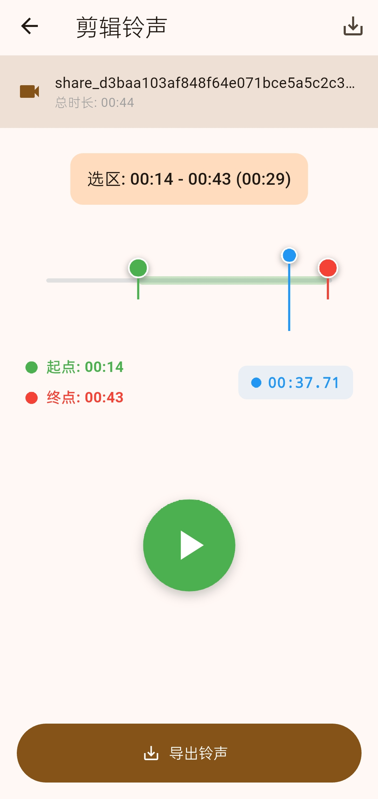
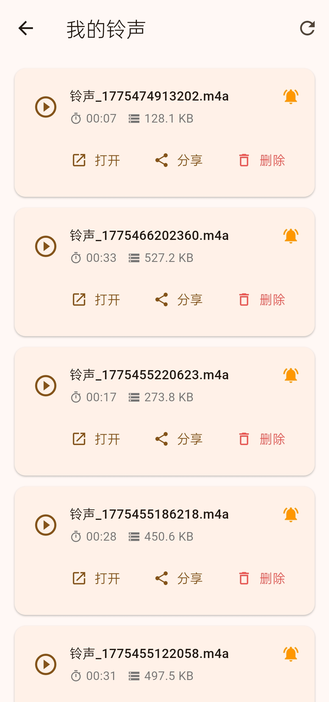

# 大侠铃声制作

一款简洁高效的 Android 铃声制作工具，支持音频提取、剪辑、导出和设为铃声。




## 功能特点

- **音频提取**：从视频文件中提取音频
- **铃声剪辑**：直观的单轨道剪辑界面，绿色起点 + 红色终点
- **灵活播放**：播放头可在选区内自由拖动
- **快速导出**：一键导出到 `/Download/RingtoneMaker/` 文件夹
- **设为铃声**：支持设为来电铃声、闹钟铃声、通知铃声
- **铃声库管理**：播放、分享、重命名、删除已导出的铃声

## 技术栈

- **框架**：Flutter
- **音频处理**：just_audio
- **平台**：Android（支持 Android 8.0+ Adaptive Icon）

## 安装使用

### 下载 APK

从 [Releases](../../releases) 页面下载最新版本的 APK 文件，直接安装即可。

### 开发构建

```bash
# 克隆项目
git clone <repository-url>
cd RingtoneMaker

# 安装依赖
flutter pub get

# 运行调试版本
flutter run

# 构建 Release 版本
flutter build apk --release
```

## 项目结构

```
lib/
├── main.dart              # 应用入口
├── home_page.dart        # 首页 - 文件选择
├── editor_page.dart      # 剪辑页面 - 铃声制作
├── history_page.dart     # 铃声库 - 管理已导出铃声
└── services/
    ├── audio_service.dart    # 音频处理服务
    └── ringtone_service.dart # 铃声设置服务
```

## 许可证

本项目基于 [MIT License](LICENSE) 开源许可。
