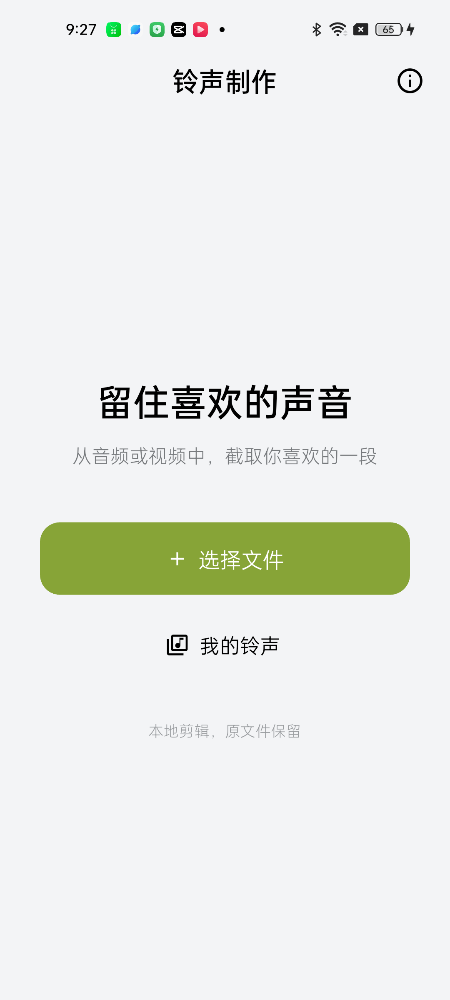
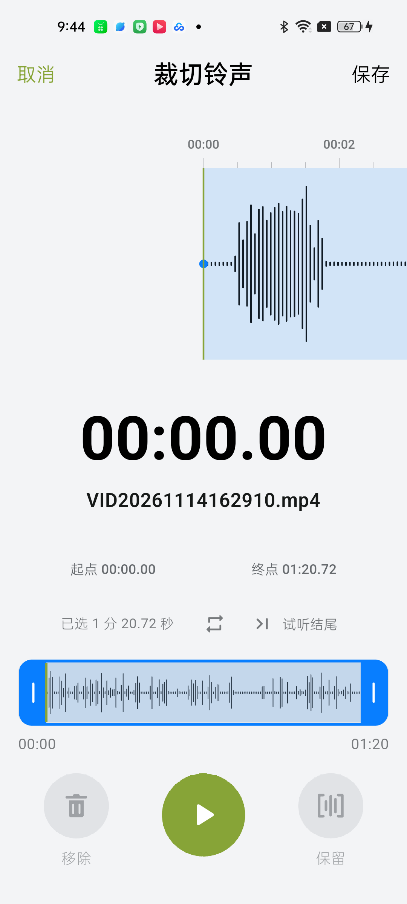
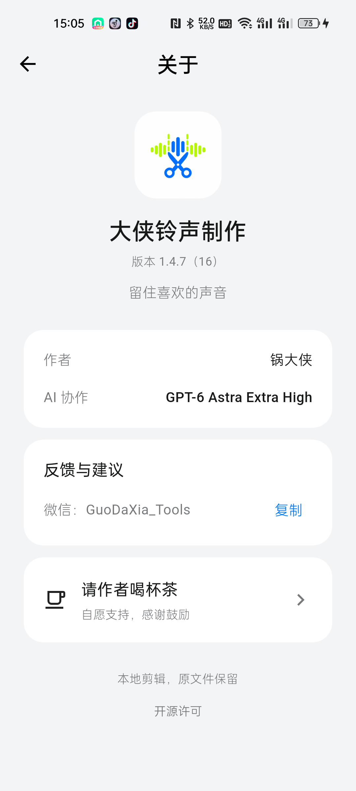

# 大侠铃声制作

面向 Android 8.0 及以上的轻量音频、视频铃声制作工具。

## 界面预览

从音频或视频中选取片段，查看清晰波形、微调起止位置，再保存为铃声。以下为应用在 realme 手机上运行时的实际界面。

<table>
  <tr>
    <td align="center"><b>选择音视频</b></td>
    <td align="center"><b>波形裁剪</b></td>
    <td align="center"><b>关于与反馈</b></td>
  </tr>
  <tr>
    <td></td>
    <td></td>
    <td></td>
  </tr>
</table>

**裁剪操作：** 拖动上下波形的边界选择片段，播放头固定在中央；播放试听后，保存选中内容。

## 裁切界面

- 上方为可左右拖动、双指缩放的大波形。绿色播放头始终位于正中间，波形在它下面移动。
- 双击上方波形切换播放与暂停；播放头在选区终点时，从选区起点重新播放。长按弹出“设置起点 / 设置终点”菜单，正在播放时会先暂停。标记采用长按识别时中央播放头的位置，不会采用手指点击位置；等待暂停及显示菜单期间时间保持不变。会使选区交叉或短于 0.1 秒的选项置灰。
- 拖动上方蓝色起止线只调整选区，下方手柄同步更新，播放头时间保持不变；拖动下方手柄才将播放头定位到相应边界。
- 下方显示整个当前音频，只接受左右手柄拖动，不接受中间区域的拖动或点击定位。
- 下方手柄向选区外侧延伸，播放头到达边界时贴合手柄内侧；按住手柄不同位置拖动均保持原有抓取偏移，避免边界跳动。
- 暂停后拖动下方手柄，会保留原播放位置为带顶部标记的固定虚线。左右手柄靠近时吸附到准确时间点并轻微振动，继续拖远可脱离；不会吸附到使选区交叉或过短的位置。松手及再次拖动仍保留参考点，重新播放、拖动上方波形定位或完成内容编辑后清除。
- 中间显示带百分之一秒的播放头时间及文件名；小波形下方分别显示播放头整秒时间和当前总时长。
- 播放时普通拖动大波形定位保持播放；拖动上方蓝色边界会暂时暂停，边界变红，松手后恢复原来的播放状态。下方手柄始终带着播放头移动，拖到结束边界松手后停在该处，再次播放从选区起点开始。
- 波形竖线与音频时间绑定，缓存采样后整体平移。长文件名前部省略，保留尾部，长按可查看全名。
- 播放头位于终点时再次播放，从选区起点开始。正常播放到选区终点后停止。
- 拖动参考虚线松手后消失；播放参考虚线在停止或播放结束后消失。
- “移除”删除选区并拼接剩余部分；“保留”只保留选区。操作后仍可继续编辑。
- 顶部支持撤销与重做；撤销后进行新的编辑会清空重做记录。
- “保存”在存在局部选区时默认导出选中片段，也可以切换为全部编辑结果；导出不会改变当前编辑内容。
- 选区显示起点、终点和长度，点击时间可以输入精确位置、按 0.05 秒微调，或设为当前播放位置。
- 循环试听默认关闭；开启时图标显示与选区边界一致的蓝色，关闭时为灰色。开启后自动重复选区，回到起点时编辑按钮保持可用且不闪烁。回跳期间可暂停、调整边界或编辑，后续播放遵从最新操作。主界面的“试听结尾”只播放最后两秒并停止。
- 移除、保留可用时为白底黑色图标，保存文字为黑色；不可用时变灰。
- 已移除或保留的内容未保存时，离开会提示继续编辑或放弃修改。
- 保存时可展开声音选项，独立开启或关闭淡入、淡出，默认均关闭；每项可选 0.2、0.5、1 秒，短音频自动缩短渐变窗口。试听开头/结尾会渲染前/后 3 秒，使用与正式导出相同的音频处理，关闭弹层会停止试听并清理临时文件。
- 首页、铃声库及保存完成面板统一浅灰背景与绿色主操作；保存后不会自动播放，可主动试听、分享、设为铃声或查看铃声库。

编辑只记录原音频的保留片段，原文件不变；最终保存时统一解码、拼接并编码一次，避免多次有损压缩。保存后可在铃声库试听、分享、重命名、删除或设置来电/闹钟/通知铃声。

## 关于页面

- 首页右上角打开“关于”，展示当前图标、安装版本、作者锅大侠及 AI 协作 GPT-6 Astra Extra High。
- 微信号 GuoDaXia_Tools 可一键复制；打开页面及复制无需存储授权。
- “请作者喝杯茶”展示原始微信赞赏码，点击“保存到相册”将原图存入 Pictures/RingtoneMaker；Android 8/9 在保存时请求存储授权，失败可重试。
- 底部提供开源许可入口。

## 文件和兼容性

- 导出为 128 kbps AAC/M4A，保存在公共 Download/RingtoneMaker 目录，同名自动加序号。
- Android 10 及以上使用 MediaStore；Android 8/9 需存储授权。设置铃声需“修改系统设置”授权。
- 依赖设备系统解码器，支持的封装、编码组合因设备而异。
- 波形保留原始峰值和 RMS 数据，上下波形均按所覆盖时间的能量绘制单色柱，全览不再使用数秒内的最高峰。首段分析后固定显示增益，缩放、播放和剪辑不会重新归一化。解码分批推送已完成的包络，未分析区域留空。按原文件 URI、大小、修改时间缓存，缺少可靠修改时间时校验内容；波形缓存上限 64 MB。普通本地文件直接读取，不再每次导入复制。导出暂存选中片段 PCM，临时磁盘占用随保留长度增长，完成或失败后清理。
- AAC 编码帧及延迟可能使最终时长与界面存在少量差异。

## 开发与验证

Flutter 3.41 / Dart 3.11 或兼容版本，Android SDK，JDK 17 或以上。

```sh
flutter pub get
flutter analyze
flutter test
flutter build apk --release --target-platform android-arm,android-arm64
```

Release 沿用原工程的调试签名，供本地体验；正式发布需配置发布签名。

主要文件：

- lib/editor_page.dart：编辑与播放状态、连续编辑和保存
- lib/audio_timeline.dart：原始片段映射、移除、提取
- lib/waveform_data.dart：能量前缀和、时间加权汇总和编辑后波形映射
- android/app/src/main/kotlin/com/ringtone/ringtone_maker/WaveformAnalyzer.kt：渐进解码、包络和持久缓存
- android/app/src/main/kotlin/com/ringtone/ringtone_maker/AudioSourceAccess.kt：直接读取文档 URI，不支持定位的数据源回退到本地缓存
- lib/widgets/recorder_waveforms.dart：居中波形、标尺、参考线和总览手柄
- android/app/src/main/kotlin/com/ringtone/ringtone_maker/AudioProcessor.kt：分块解码和多片段统一导出

自动测试覆盖片段映射、连续编辑、边界约束、波形手势、播放不中断、虚线生命周期、撤销和授权失败恢复。
test_driver/device_smoke.dart 是独立的设备验证入口，生成已知音频信号，验证真实拼接/提取导出的时长与信号幅度，以及跨片段定位时的播放状态；验证导出文件会自动清理，不会操作用户已有铃声。

原始版本在 Git 分支 backup/before-waveform-20261102。本次重构前的可用源码快照保存在本次 Codex 工作目录 work/before-centered-editor.zip。

MIT，见 LICENSE。
